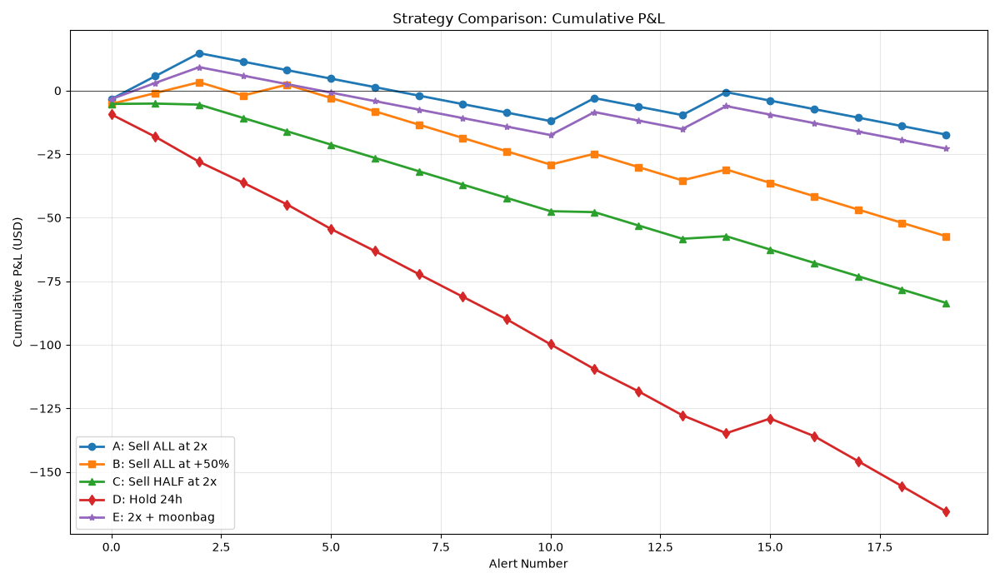
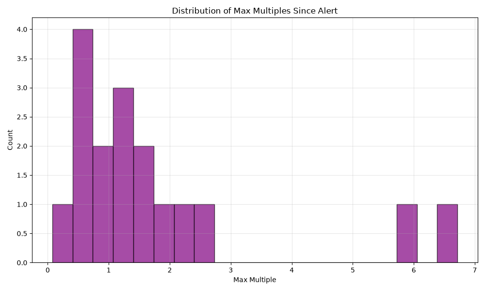
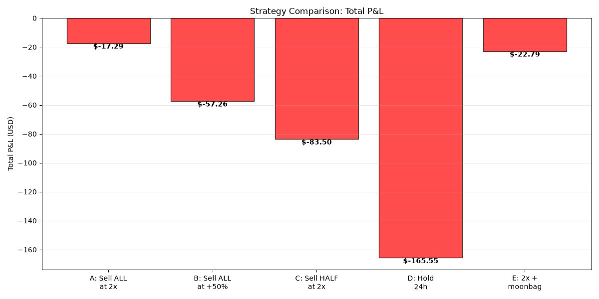

# PAPER TRADING - NO REAL MONEY

## Memecoin Paper-Trading Dashboard

**📊 [View Live Dashboard](https://andreolf.github.io/memecoin-paper-tracker/)**

This dashboard tracks theoretical P&L from Solana memecoin alerts. **No actual trades are executed.**

**Last Updated:** 2026-10-30 04:32 CET

**Tracked:** 20 pre-V2 real alerts + 1 Rules V2 trades + 131 missed (filtered out)

---

## 🆕 Regole V2 (since 2026-10-28 09:39 CET / 16:39 WITA)

Pre-registered paper test after the post-mortem. **Entry** = logged live price. **Exit** = sell 100% at the first touch of **2x**, or stop at the first touch of **−20%** (0.80x) before 2x. **No moonbag.** **Cost** 0.45% fee + 2% slippage per leg (~4.9% round trip). Applies to alerts from 2026-10-28T08:39Z (or reason starting with `v2`); scored separately from the pre-V2 history below.

| V2 trades | Wins (2x) | Stops (−20%) | Open | Win rate (closed) | Realized P&L | Open (mark) | Total @ $10/trade |
|---|---|---|---|---|---|---|---|
| **1 / 50** | 0 | 1 | 0 | 0.0% | −$2.39 | $0.00 | **−$2.39** |

Per trade: a 2x win nets +$9.03, a −20% stop −$2.39 → breakeven win rate ≈ 21%.

| Token | Alert | Max multiple | Outcome | P&L |
|---|---|---|---|---|
| Steve | 2026-10-29 07:43 CET | 1.25x | stop −20% | −$2.39 |

---

## 📊 Strategy Comparison (pre-V2 history)

Pre-V2 real alerts only (before 2026-10-28T08:39Z). All strategies use:
- **$10 stake per alert**
- **0.45% trading fee + 2% slippage per leg**
- **Stop-loss**: A and E use **-30%** (changed from -50% on 2026-10-24 16:35 CEST, applied to all alerts here); B, C and the "(−50%, old)" comparison rows use -50%
- **Order check**: if both stop and target were reached, the target counts only if GeckoTerminal 1-min candles show it was touched first; same minute or unknown order → stop first (conservative)

**🏆 Current Best Performer: A: Sell ALL at 2x** (Total P&L: $-17.29)

### Overall Performance

| Strategy | Description | Total Alerts | Total P&L | Win Rate | Avg P&L | Best Trade | Worst Trade |
|----------|-------------|--------------|-----------|----------|---------|------------|-------------|
| ⭐ A: Sell ALL at 2x | Sell all at 2x, -30% stop | 20 | **$-17.29** | 20.0% | $-0.86 | $9.03 | $-3.34 |
| B: Sell ALL at +50% | Sell all at 1.5x, -50% stop | 20 | **$-57.26** | 25.0% | $-2.86 | $4.27 | $-5.24 |
| C: Sell HALF at 2x | Sell half at 2x, hold rest, -50% stop | 20 | **$-83.50** | 10.0% | $-4.17 | $1.01 | $-5.24 |
| D: Hold 24h | Hold 24h then sell | 20 | **$-165.55** | 5.0% | $-8.28 | $5.78 | $-9.92 |
| E: 2x + moonbag | Sell 85% at 2x, keep 15% moonbag (narr ≥4, marked at current price, not at peak), -30% stop before 2x | 20 | **$-22.79** | 20.0% | $-1.14 | $9.03 | $-3.34 |
| A (−50%, old) | A with the old -50% stop (comparison) | 20 | **$-47.74** | 20.0% | $-2.39 | $9.03 | $-5.24 |
| E (−50%, old) | E with the old -50% stop (comparison) | 20 | **$-53.25** | 20.0% | $-2.66 | $9.03 | $-5.24 |

---

## 📈 Performance by Alert Type

### Strategy A: Sell ALL at 2x

| Type | Count | Total P&L | Realized | Unrealized | Win Rate | Avg Max Multiple |
|------|-------|-----------|----------|------------|----------|------------------|
| new | 20 | $-17.29 | $-17.29 | $0.00 | 20.0% | 1.77x |

### Strategy B: Sell ALL at +50%

| Type | Count | Total P&L | Realized | Unrealized | Win Rate | Avg Max Multiple |
|------|-------|-----------|----------|------------|----------|------------------|
| new | 20 | $-57.26 | $-57.26 | $0.00 | 25.0% | 1.77x |

### Strategy C: Sell HALF at 2x

| Type | Count | Total P&L | Realized | Unrealized | Win Rate | Avg Max Multiple |
|------|-------|-----------|----------|------------|----------|------------------|
| new | 20 | $-83.50 | $-65.81 | $-17.69 | 10.0% | 1.77x |

### Strategy D: Hold 24h

| Type | Count | Total P&L | Win Rate | Avg Max Multiple |
|------|-------|-----------|----------|------------------|
| new | 20 | $-165.55 | 5.0% | 1.77x |

---

## 📉 Charts

### Cumulative P&L Comparison

### Max Multiple Distribution

### Strategy Total P&L

---

## 🔗 Interactive Dashboard

View the full interactive dashboard: [dashboard/index.html](dashboard/index.html)

Or visit: **https://andreolf.github.io/memecoin-paper-tracker/**

---

## ⚠️ Disclaimer

This is a **paper-trading tracker only**. No real trades are executed. All P&L figures are theoretical and based on simulated strategies with assumed execution at specific price levels plus 2% slippage. Actual trading results would differ significantly due to additional slippage, timing, liquidity constraints, MEV, and market conditions.

**Assumptions:**
- 0.45% trading fee per leg
- 2% slippage per leg
- Perfect execution at target/stop prices (unrealistic)
- No MEV or sandwich attacks
- Conservative ordering when order unknown

---

*Auto-generated by scripts/refresh.py*
