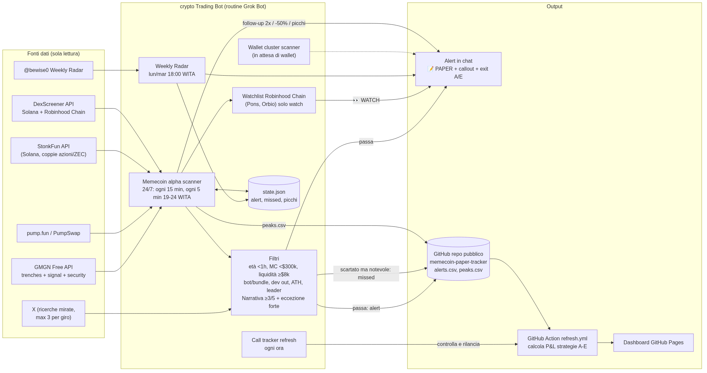

# Architettura: memecoin paper-trading bot

Bot di scouting per memecoin Solana appena lanciate. **Non fa trade**: manda alert in paper trading e misura il P&L teorico su questa dashboard.

- **Fonti (sola lettura):** GMGN Free API, pump.fun / PumpSwap, StonkFun API, DexScreener (Solana + Robinhood Chain), ricerche mirate su X, Weekly Radar di @bewise0.
- **Scanner:** gira 24/7 (ogni 15 min, ogni 5 min la sera WITA). Filtri: età < 1h, MC < $300k, liquidità ≥ $8k, bot/bundle, dev venduto, distanza dall'ATH, leader tra le copie, punteggio narrativa ≥ 3/5 (con un'eccezione per narrative molto forti e contratti puliti).
- **Robinhood Chain:** solo watchlist (Pons, Orbio), niente paper trading.
- **Output:** alert in chat con regole di uscita (A: vendi tutto a 2x; E: 85% a 2x + 15% moonbag; stop −50%). Ogni alert e ogni coin scartato ma notevole ("missed") finisce in `data/alerts.csv`; i picchi in `data/peaks.csv`.
- **Dashboard:** una GitHub Action (`refresh.yml`) ricalcola le strategie A–E e pubblica la pagina su GitHub Pages; un controllo orario la rilancia se è ferma.

Sorgente del diagramma: [`architecture.mmd`](architecture.mmd) (Mermaid).
